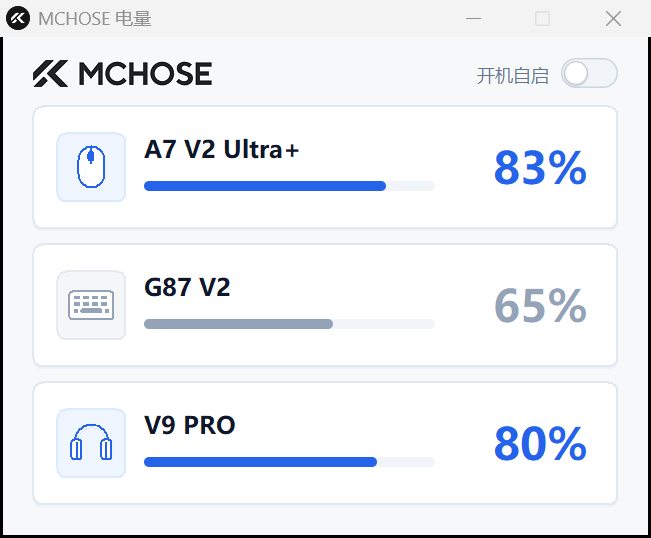
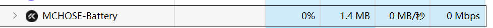

# MC Battery

[](https://github.com/Tensyd/mchose-battery/actions/workflows/ci.yml)

专为迈从（MCHOSE）无线外设打造的**极简轻量电量托盘小工具**。

摒弃臃肿复杂的官方控制驱动，追求极致纯净与性能：**只专注显示电量、单文件绿色免安装、实测内存仅 ~1.5 MB、静置 CPU 占用恒为 0%**。

---

## 界面一览

### 1. 极简卡片主界面
界面纯粹利落，去除所有解释性废话与冗杂广告，仅保留官网品牌字标与三张设备卡片（图标、型号、百分比、圆润电量条）：



### 2. 任务栏托盘电量摘要
鼠标悬停于任务栏图标即可快速预览全部设备当前电量，左键恢复窗口，右键便捷退出：


提示文案格式为 `MC Battery | 鼠标 … · 键盘 … · 耳机 …`（截图是改名前的版本，名称处仍显示旧名）。

### 3. 超低资源占用实测
单文件原生纯 Win32 / GDI / Rust 编写，彻底告别 Electron 与 WebView2 的庞大资源吞噬，任务管理器实测仅占用约 **1.5 MB** 内存（截图为早期版本，读数随刷新线程略有浮动）：



窗口没有文本输入，程序会主动解除输入法关联（`ImmAssociateContextEx`）。否则一旦窗口获得焦点，系统输入法就会把自己的 DLL 与 DirectWrite 图形栈注入进程——实测会凭空多出约 5 MB，而这些功能本程序根本用不到。

可能让人不解的是：同样的程序，焦点落到窗口前后，任务管理器里能差出好几兆。原因就在这里，不在程序本身。

---

## 核心特性

- 🎯 **极简纯粹，只显电量**：不塞设置页、不加固件广告推送、不弹窗打扰；界面清晰呈现剩余电量与胶囊进度条。
- 🚀 **绿色单文件，即开即用**：体积仅约 460 KB，单文件可执行程序，解压即用、免安装；不写系统垃圾，不依赖任何第三方运行时（无 Electron / WebView2 / Python / .NET）。
- ⚡ **超低系统占用**：任务管理器实测物理内存约 **1.5 MB**（专用提交内存仅 ~2 MB），静置 CPU 占用严格恒定为 **0%**。
- 💤 **休眠式零轮询架构**：不启动定时后台循环刷盘与唤醒，仅在窗口获得焦点（聚焦）或鼠标点击时按需读取一次，其余时间 100% 挂起休眠。
- 🔴 **直观低电量告警**：≤ 20% 电量智能标红（百分比数值与进度条同步转红警示）；大于 20% 呈现品牌科技蓝；未连接或不可用时灰显 `--`，绝不虚构数据。
- 🖥️ **Windows 原生体验融合**：
  - 内嵌官方高分辨率多尺寸 ICO 图标资源，在**任务管理器、任务栏、窗口标题栏**均能完美呈现品牌标。
  - 开机自启开关写入当前用户启动项（`HKCU Run`），无需管理员权限。
  - 关闭主窗口自动最小化隐藏至系统托盘常驻。

---

## 下载使用

无需安装任何环境，直接下载单文件即可运行：

👉 **前往 [Releases 页面](https://github.com/Tensyd/mchose-battery/releases) 下载最新版 `MC-Battery.exe`**，双击直接运行。

支持系统：Windows 10 / Windows 11（x64）。

---

## 支持的设备

| 设备 | 连接方式 | 识别标识 | 适配状态 |
| --- | --- | --- | --- |
| **A7 V2 Ultra+** 鼠标 | 2.4G 接收器 | `3837:100B` | 已实机验证 |
| **G87 V2** 键盘 | 2.4G 接收器 | `3837:201B` | 已实机验证 |
| **V9 PRO** 耳机 | 2.4G 接收器 | `291D:385D` | 已实机验证 |

> 📌 **说明**：当前版本严格针对上述三款原装接收器接口适配，所有电量查询均为经过验证的只读 HID 报文，不发送任何未知写指令，确保安全稳定。候选型号支持计划与证据等级详见 [docs/compatibility.md](docs/compatibility.md)。

### 有新设备想反馈？

程序带一个接口诊断模式，两档：

```text
MC-Battery.exe --diagnose           # 只枚举，不打开设备、不发任何指令
MC-Battery.exe --diagnose --probe   # 额外执行一次只读电量查询
```

报告生成在 exe 同目录的 `mchose-diagnose.txt`（目录不可写时改存临时目录），包含：

1. 厂商自定义接口清单（新型号最可能藏在这里）
2. 已知厂商 ID 的其他接口
3. 三款已支持型号是否被识别
4. 加 `--probe` 时，各型号的实际读取结果与失败原因

第 4 段是排查「界面只显示 `--`」的关键：它把**接收器没插**、**接口打不开**、**设备休眠**区分开，而不是笼统地不给数据。`--probe` 也只针对已支持型号，未知接口既不打开也不发送报文。

报告不读取序列号与设备路径，可以放心贴到 issue 里。附上报告、型号固件版本、以及同一时刻官方软件显示的电量，就能把新型号推进到「可离线适配」这一步。

---

## 数据与状态约定

- **数据诚实**：读取失败时直接显示 `--`，不展示伪造数值。
- **休眠保留**：键盘休眠无响应时保留上次有效读数并以灰色显示；接收器拔出则立刻清空。
- **耳机独立**：耳机接收器无法区分关机与超出范围，未连接时不保留陈旧读数。
- **数值口径**：程序读取并展示硬件报文中的真实电量百分比，部分设备可能与官方软件按 10% 档位取整的数值略有差异。

---

## 本地构建

如果你希望自行从源码构建：

```bash
# 克隆仓库
git clone https://github.com/Tensyd/mchose-battery.git
cd mchose-battery

# 构建 Release 单文件
cargo build --release
```

产物位于 `target/release/mc-battery.exe`。`build.rs` 会自行生成 `.rsrc` 资源段，把 `assets/app.ico` 与版本信息（取自 `Cargo.toml`）一起链接进二进制，无需安装 `windres` 或 `rc.exe`。

---

## 项目结构

```text
src/
  main.rs          程序入口（--diagnose 走诊断分支）
  device/          设备协议与驱动层
    mod.rs           快照、读数状态与按实例缓存隔离
    spec.rs          支持设备表（识别四元组、协议绑定、显示策略）
    protocol.rs      三款设备的只读查询报文与响应解析
    transport.rs     HID 传输抽象（系统 Link 与离线测试 MockLink）
    match_rules.rs   接口四元组匹配规则
  diagnose.rs      被动枚举诊断：只列接口，不打开设备、不发指令
  ui.rs            极简卡片界面、SDF解析抗锯齿绘制与按需刷新调度
  tray.rs          系统托盘管理与悬停电量摘要
  autostart.rs     开机自启注册表读写实现
  logo.bgra        官网表头字标预渲染位图
  app-icon.bgra    程序图标位图
assets/
  app.ico          嵌入式多尺寸 Windows 资源图标
docs/
  compatibility.md 设备支持状态、五级证据体系与扩展候选
  taskmanager.png  任务管理器超低占用截图
  tray.png         托盘悬停电量摘要截图
build.rs           自动生成 .rsrc COFF 资源段
```

---

## 许可证

本项目采用 [MIT 许可证](LICENSE)。
